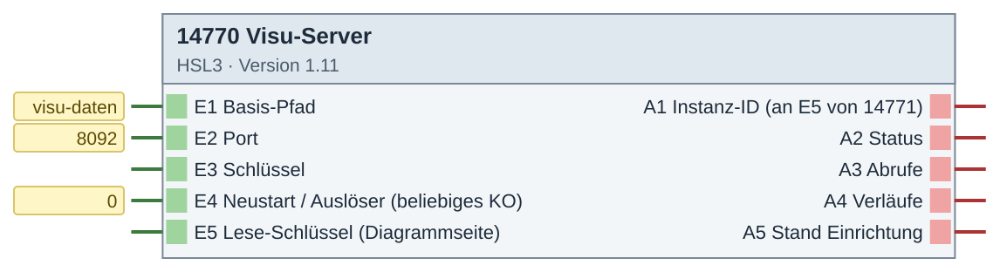
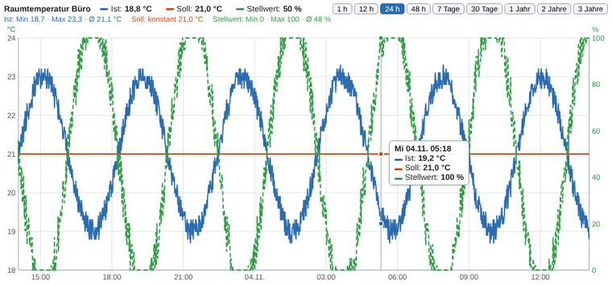
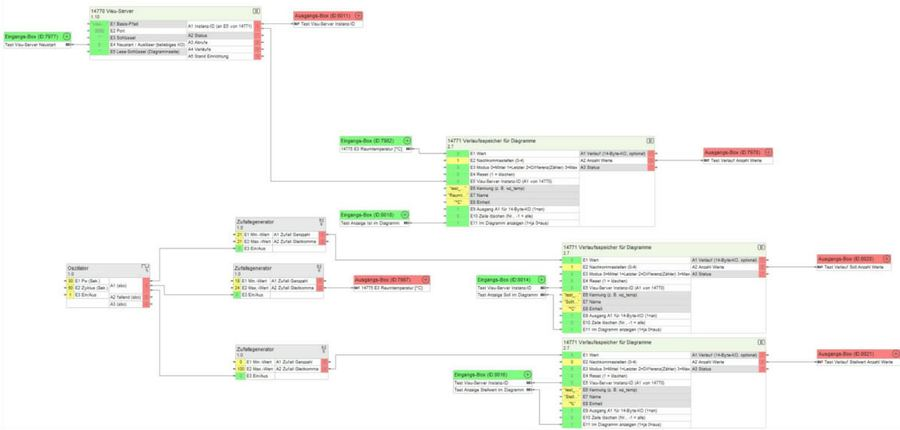

# 14770 Visu-Server – Version 1.11

**ID 14770 · Version 1.11 · HSL3**

homeserver-webapp, Diagramme.

Der HomeServer leitet `https://<HS>/visu-daten/` an den Baustein (Port 8092) weiter – gleiche Adresse und gleiches Zertifikat wie der HS.

## Baustein

## Beispiel

**Ergebnis: interaktives Diagramm in der Visu (Testdaten)**

**Beispiel: Verdrahtung im Experten (Testprojekt mit Zufallswerten)**

## Eingänge

- E1 Basis-Pfad
- E2 Port
- E3 Schlüssel
- E4 Neustart / Auslöser (beliebiges KO)
- E5 Lese-Schlüssel (Diagrammseite)

## Ausgänge

- A1 Instanz-ID (an E5 von 14771)
- A2 Status
- A3 Abrufe
- A4 Verläufe
- A5 Stand Einrichtung

## Dateien

- `14770_visuserver.hslz` – Import im Experten: Logikbausteine → Importieren
- `Quellen/DE-log14770.html` – ausführliche Hilfe (im Experten über die Bausteinhilfe)
- `Quellen/src/…py`, `Quellen/config.json` – Quellcode; die `.hsl` erzeugt der Gira-Generator (HSL3 SDK, nicht enthalten)
- [`Anleitung_Einbau.md`](Anleitung_Einbau.md) – Einbau Schritt für Schritt
- `WebApp/homeserver-webapp/` – die HTML5-Visu zum Baustein

iKOs bei Bedarf per CSV-Import anlegen: Kommunikationsobjekte → Extras → Datenabgleich → CSV-Datei synchronisieren/importieren.

[← zur Übersicht](../README.md)
