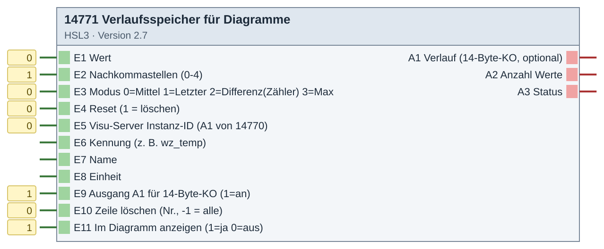
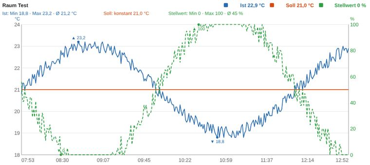
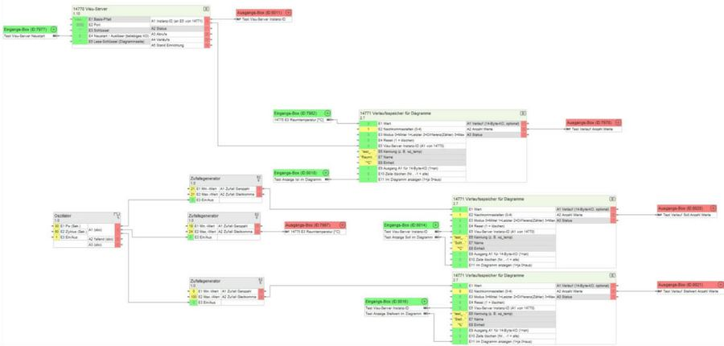

# 14771 Verlaufsspeicher für Diagramme – Version 2.7

**ID 14771 · Version 2.7 · HSL3**

zusammen mit 14770.

## Baustein

## Beispiel

**Ergebnis: interaktives Diagramm in der Visu (Testdaten)**

**Beispiel: Verdrahtung im Experten (Testprojekt mit Zufallswerten)**

## Eingänge

- E1 Wert
- E2 Nachkommastellen (0-4)
- E3 Modus 0=Mittel 1=Letzter 2=Differenz(Zähler) 3=Max
- E4 Reset (1 = löschen)
- E5 Visu-Server Instanz-ID (A1 von 14770)
- E6 Kennung (z. B. wz_temp)
- E7 Name
- E8 Einheit
- E9 Ausgang A1 für 14-Byte-KO (1=an)
- E10 Zeile löschen (Nr., -1 = alle)
- E11 Im Diagramm anzeigen (1=ja 0=aus)

## Ausgänge

- A1 Verlauf (14-Byte-KO, optional)
- A2 Anzahl Werte
- A3 Status

## Dateien

- `14771_verlauf.hslz` – Import im Experten: Logikbausteine → Importieren
- `Quellen/DE-log14771.html` – ausführliche Hilfe (im Experten über die Bausteinhilfe)
- `Quellen/src/…py`, `Quellen/config.json` – Quellcode; die `.hsl` erzeugt der Gira-Generator (HSL3 SDK, nicht enthalten)
- [`Anleitung_Einbau.md`](Anleitung_Einbau.md) – Einbau Schritt für Schritt

iKOs bei Bedarf per CSV-Import anlegen: Kommunikationsobjekte → Extras → Datenabgleich → CSV-Datei synchronisieren/importieren.

[← zur Übersicht](../README.md)
