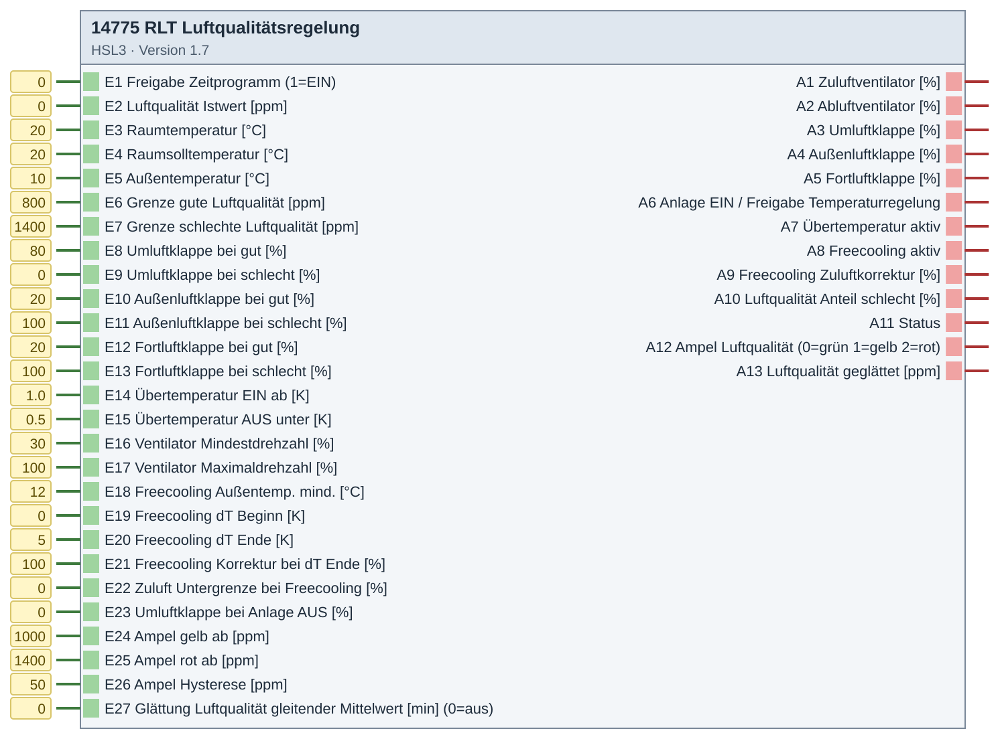
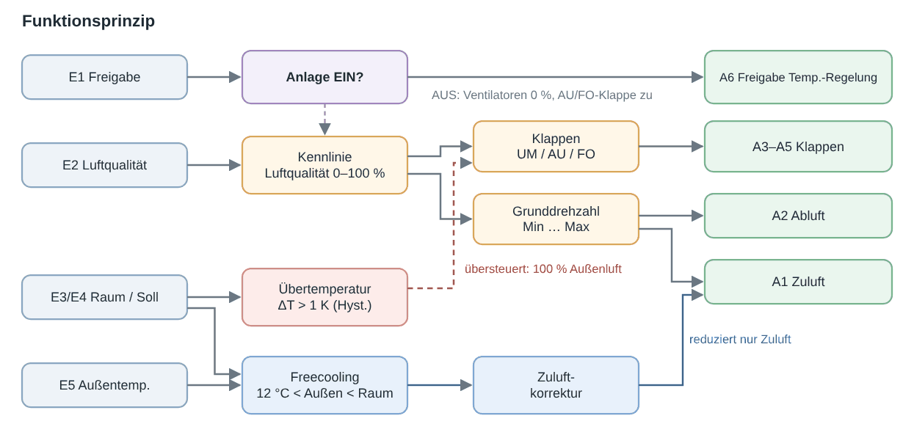
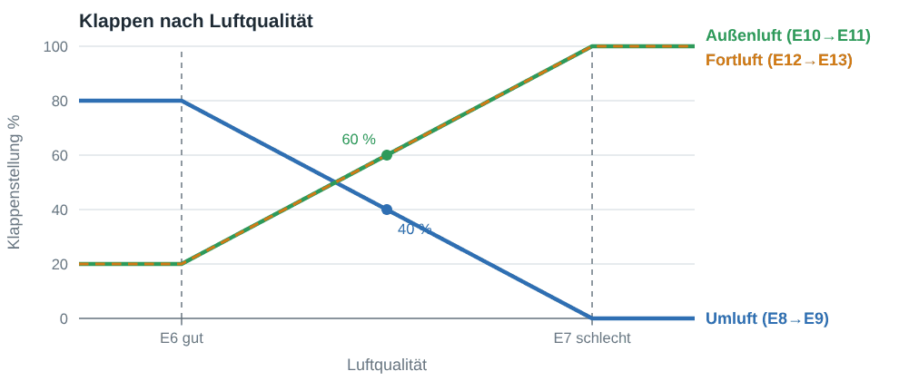

# 14775 RLT Luftqualitätsregelung – Version 1.7

**ID 14775 · Version 1.7 · HSL3**

Lüftungsanlage (RLT) mit Luftqualitätsregelung.

**Neu in 1.7:** E27 Glättung – gleitender, zeitgewichteter Mittelwert der Luftqualität über E27 Minuten (0 = aus). Kurze Spitzen lassen Drehzahl und Klappen ruhig; A13 gibt den geglätteten Wert aus.

## Baustein

## Beispiel

**Funktionsprinzip**

**Beispiel: Klappenstellungen**

## Eingänge

- E1 Freigabe Zeitprogramm (1=EIN)
- E2 Luftqualität Istwert [ppm]
- E3 Raumtemperatur [°C]
- E4 Raumsolltemperatur [°C]
- E5 Außentemperatur [°C]
- E6 Grenze gute Luftqualität [ppm]
- E7 Grenze schlechte Luftqualität [ppm]
- E8 Umluftklappe bei gut [%]
- E9 Umluftklappe bei schlecht [%]
- E10 Außenluftklappe bei gut [%]
- E11 Außenluftklappe bei schlecht [%]
- E12 Fortluftklappe bei gut [%]
- E13 Fortluftklappe bei schlecht [%]
- E14 Übertemperatur EIN ab [K]
- E15 Übertemperatur AUS unter [K]
- E16 Ventilator Mindestdrehzahl [%]
- E17 Ventilator Maximaldrehzahl [%]
- E18 Freecooling Außentemp. mind. [°C]
- E19 Freecooling dT Beginn [K]
- E20 Freecooling dT Ende [K]
- E21 Freecooling Korrektur bei dT Ende [%]
- E22 Zuluft Untergrenze bei Freecooling [%]
- E23 Umluftklappe bei Anlage AUS [%]
- E24 Ampel gelb ab [ppm]
- E25 Ampel rot ab [ppm]
- E26 Ampel Hysterese [ppm]
- E27 Glättung Luftqualität gleitender Mittelwert [min] (0=aus)

## Ausgänge

- A1 Zuluftventilator [%]
- A2 Abluftventilator [%]
- A3 Umluftklappe [%]
- A4 Außenluftklappe [%]
- A5 Fortluftklappe [%]
- A6 Anlage EIN / Freigabe Temperaturregelung
- A7 Übertemperatur aktiv
- A8 Freecooling aktiv
- A9 Freecooling Zuluftkorrektur [%]
- A10 Luftqualität Anteil schlecht [%]
- A11 Status
- A12 Ampel Luftqualität (0=grün 1=gelb 2=rot)
- A13 Luftqualität geglättet [ppm]

## Dateien

- `14775_RLT_Luftqualitaet.hslz` – Import im Experten: Logikbausteine → Importieren
- `Quellen/DE-log14775.html` – ausführliche Hilfe (im Experten über die Bausteinhilfe)
- `Quellen/src/…py`, `Quellen/config.json` – Quellcode; die `.hsl` erzeugt der Gira-Generator (HSL3 SDK, nicht enthalten)

iKOs bei Bedarf per CSV-Import anlegen: Kommunikationsobjekte → Extras → Datenabgleich → CSV-Datei synchronisieren/importieren.

[← zur Übersicht](../README.md)
