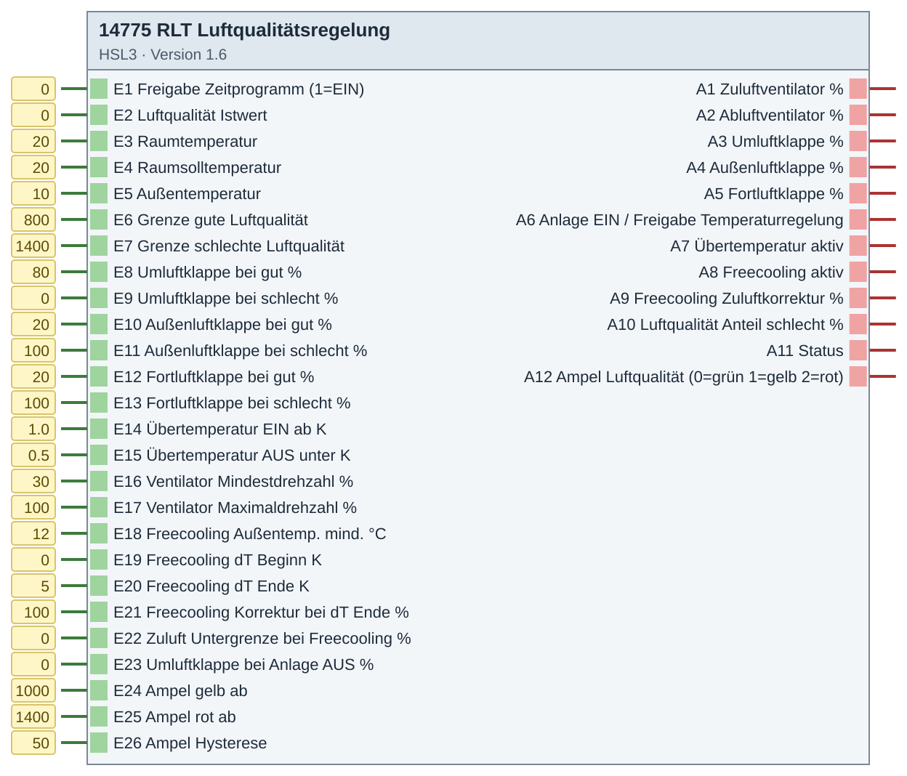
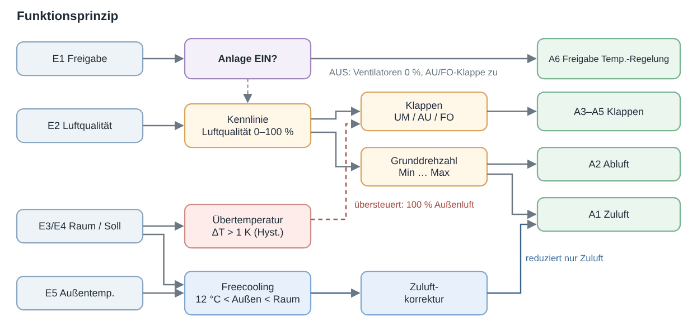
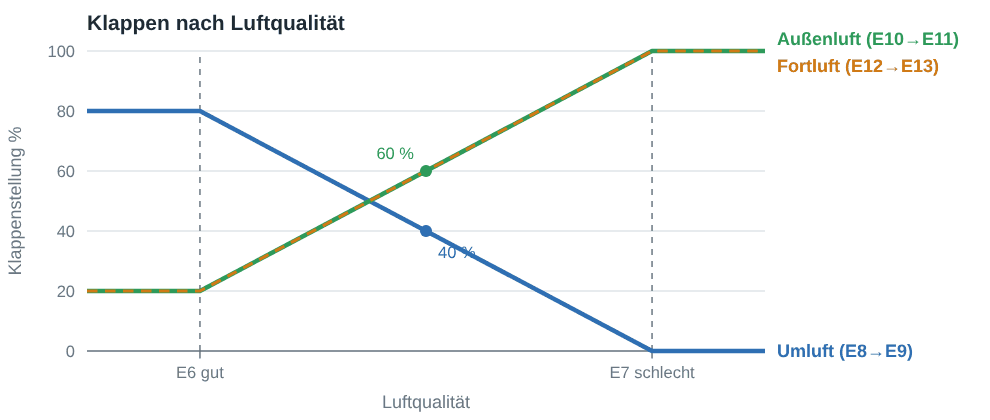

# 14775 RLT Luftqualitätsregelung – Version 1.6

**ID 14775 · Version 1.6 · HSL3**

Lüftungsanlage (RLT) mit Luftqualitätsregelung.

## Baustein

## Beispiel

**Funktionsprinzip**

**Beispiel: Klappenstellungen**

## Eingänge

- E1 Freigabe Zeitprogramm (1=EIN)
- E2 Luftqualität Istwert
- E3 Raumtemperatur
- E4 Raumsolltemperatur
- E5 Außentemperatur
- E6 Grenze gute Luftqualität
- E7 Grenze schlechte Luftqualität
- E8 Umluftklappe bei gut %
- E9 Umluftklappe bei schlecht %
- E10 Außenluftklappe bei gut %
- E11 Außenluftklappe bei schlecht %
- E12 Fortluftklappe bei gut %
- E13 Fortluftklappe bei schlecht %
- E14 Übertemperatur EIN ab K
- E15 Übertemperatur AUS unter K
- E16 Ventilator Mindestdrehzahl %
- E17 Ventilator Maximaldrehzahl %
- E18 Freecooling Außentemp. mind. °C
- E19 Freecooling dT Beginn K
- E20 Freecooling dT Ende K
- E21 Freecooling Korrektur bei dT Ende %
- E22 Zuluft Untergrenze bei Freecooling %
- E23 Umluftklappe bei Anlage AUS %
- E24 Ampel gelb ab
- E25 Ampel rot ab
- E26 Ampel Hysterese

## Ausgänge

- A1 Zuluftventilator %
- A2 Abluftventilator %
- A3 Umluftklappe %
- A4 Außenluftklappe %
- A5 Fortluftklappe %
- A6 Anlage EIN / Freigabe Temperaturregelung
- A7 Übertemperatur aktiv
- A8 Freecooling aktiv
- A9 Freecooling Zuluftkorrektur %
- A10 Luftqualität Anteil schlecht %
- A11 Status
- A12 Ampel Luftqualität (0=grün 1=gelb 2=rot)

## Dateien

- `14775_RLT_Luftqualitaet.hslz` – Import im Experten: Logikbausteine → Importieren
- `Quellen/DE-log14775.html` – ausführliche Hilfe (im Experten über die Bausteinhilfe)
- `Quellen/src/…py`, `Quellen/config.json` – Quellcode; die `.hsl` erzeugt der Gira-Generator (HSL3 SDK, nicht enthalten)

iKOs bei Bedarf per CSV-Import anlegen: Kommunikationsobjekte → Extras → Datenabgleich → CSV-Datei synchronisieren/importieren.

[← zur Übersicht](../README.md)
