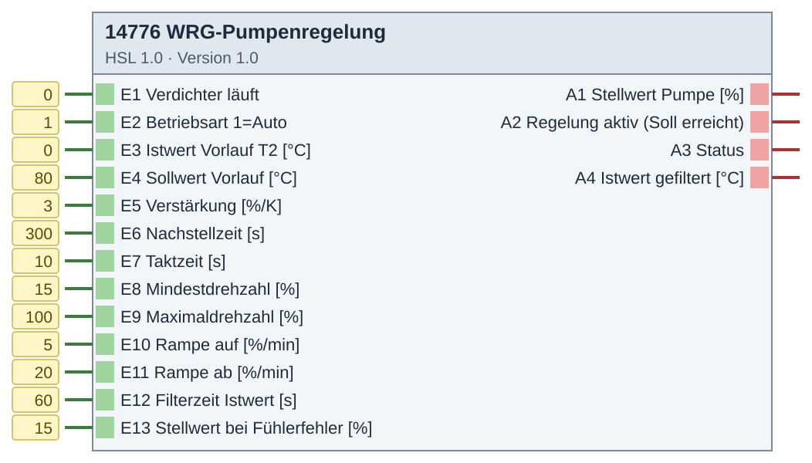
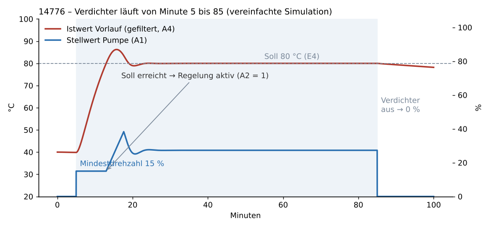

# 14776 WRG-Pumpenregelung – Version 1.0

**ID 14776 · Version 1.0 · HSL 1.0**

WRG-Pumpe an einem Druckluft-Kompressor.

## Baustein



## Beispiel

**Beispiel: Verlauf beim Einschalten des Verdichters (vereinfachte Simulation)**



## Beschreibung (aus dem Baustein)

```
BadSmiley0815 · GPL-3.0

Drehzahlregelung der WRG-Pumpe eines Kompressors auf eine Vorlauftemperatur.
- Verdichter läuft (E1=1): Pumpe sofort auf Mindestdrehzahl (E8).
- Bis der gefilterte Istwert (E3) den Sollwert (E4) erreicht, bleibt die Pumpe
  auf Mindestdrehzahl. Erst dann wird die Regelung aktiv (A2=1, bleibt aktiv bis
  der Verdichter aus ist).
- Regelung: PI-Regler, wirkt direkt (zu warm -> schneller). Startet stoßfrei bei
  der Mindestdrehzahl, Stellwert begrenzt auf E8..E9 und über Rampen E10/E11
  begrenzt. Integrator mit Anti-Windup (friert ein, solange die Rampe begrenzt).
- Verdichter aus (E1=0): Stellwert 0 (Pumpe aus), Regelung zurückgesetzt.
- E2<>1 (Hand): Baustein sendet nichts, beim Zurückschalten neu ab Mindestdrehzahl.
- Fühlerfehler (E3 < -30 oder > 130 °C): Stellwert E13, Status 5.
A3 Status: 0=Verdichter aus, 1=Mindestdrehzahl (wartet auf Soll), 2=Regelung,
           3=Regelung an Maximaldrehzahl, 4=Hand, 5=Fühlerfehler
A1 sendet ganzzahlig und nur bei Änderung (bzw. sofort bei E1/E2-Wechsel).
## 14776 WRG-Pumpenregelung.End
```

## Eingänge

- E1 Verdichter läuft
- E2 Betriebsart 1=Auto
- E3 Istwert Vorlauf T2 [°C]
- E4 Sollwert Vorlauf [°C]
- E5 Verstärkung [%/K]
- E6 Nachstellzeit [s]
- E7 Taktzeit [s]
- E8 Mindestdrehzahl [%]
- E9 Maximaldrehzahl [%]
- E10 Rampe auf [%/min]
- E11 Rampe ab [%/min]
- E12 Filterzeit Istwert [s]
- E13 Stellwert bei Fühlerfehler [%]

## Ausgänge

- A1 Stellwert Pumpe [%]
- A2 Regelung aktiv (Soll erreicht)
- A3 Status
- A4 Istwert gefiltert [°C]

## Dateien

- `14776_WRG_Pumpenregelung.hsl` – Import im Experten: Logikbausteine → Importieren

iKOs bei Bedarf per CSV-Import anlegen: Kommunikationsobjekte → Extras → Datenabgleich → CSV-Datei synchronisieren/importieren.

[← zur Übersicht](../README.md)
