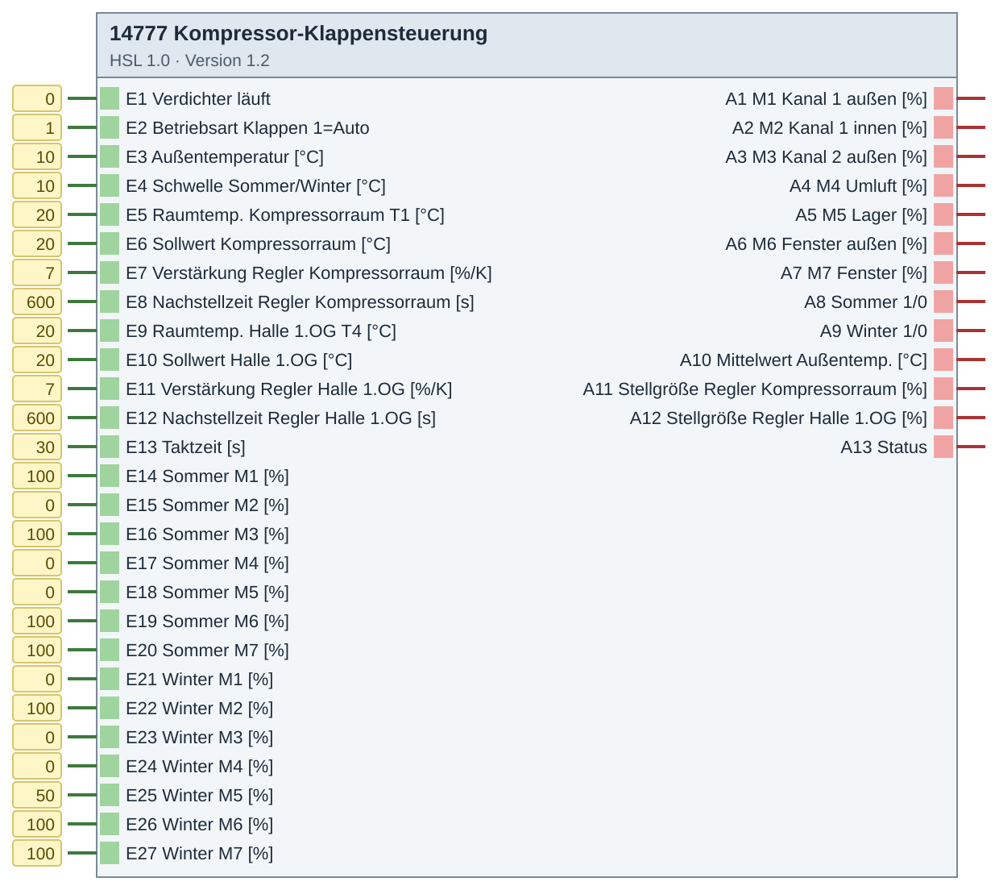
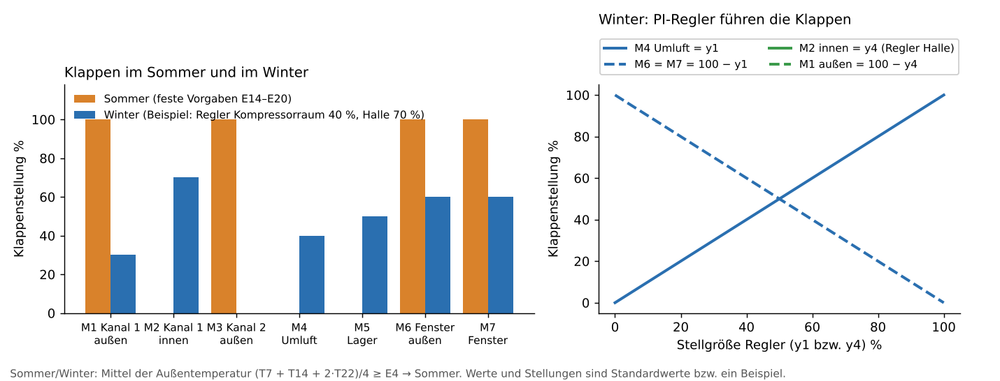

# 14777 Kompressor-Klappensteuerung – Version 1.2

**ID 14777 · Version 1.2 · HSL 1.0**

Klappen eines Kompressorraums (Sommer/Winter).

## Baustein



## Beispiel

**Beispiel: Klappenstellungen**



## Beschreibung (aus dem Baustein)

```
BadSmiley0815 · GPL-3.0

Ersetzt eine Klappen- und Raumtemperatursteuerung aus Einzelbausteinen
(Sommer/Winter 19830, 2x PID 19211, Sperren, Telegrammgeneratoren).

Sommer/Winter: Mittelwert der Außentemperatur wie 19830 aus den Werten um
  7, 14 und 22 Uhr: (T7 + T14 + 2*T22)/4, remanent. Mittel >= E4 -> Sommer.
Sommer: M1..M7 = Sommer-Vorgaben E14..E20 (gesendet bei Verdichter EIN,
  Umschaltung, Auto EIN oder Änderung einer Vorgabe). A11/A12 = 0.
Winter: M3 Kanal 2 außen und M5 Lager = Winter-Vorgaben E23/E25 (M5 Standard 50 %)
  (Abwärme geht in den Nebenraum).
  PI-Regler Kompressorraum (Fühler T1): M4 Umluft = y1, M6 = M7 = 100 - y1.
  PI-Regler Halle 1.OG (Fühler T4):     M2 innen  = y4, M1     = 100 - y4.
  Die Regler laufen im Winter immer (auch bei Verdichter AUS), Start stoßfrei
  ab Winter-Vorgabe M4 bzw. M2. Integrator auf 0..100 begrenzt.
  Fühler außerhalb -30..80 °C: Regler hält den letzten Wert.
Betriebsart E2<>1: Baustein sendet keine Klappenwerte (Hand), Status 0.
Ausgänge M1..M7 senden ganzzahlig und nur bei Änderung (bzw. erzwungen).
A13 Status: 0 = Hand, 1 = Sommer, 2 = Winter.
V1.2: Kühlregler (E28..E30, A14) entfernt; A11/A12 im Sommer 0;
      Pin-Namen Regler Kompressorraum (T1) / Halle 1.OG (T4).
V1.1: Kühlregler T1 (M3/M5 gegenläufig).  V1.0: erste Version.
## 14777 Kompressor-Klappensteuerung.End
```

## Eingänge

- E1 Verdichter läuft
- E2 Betriebsart Klappen 1=Auto
- E3 Außentemperatur [°C]
- E4 Schwelle Sommer/Winter [°C]
- E5 Raumtemp. Kompressorraum T1 [°C]
- E6 Sollwert Kompressorraum [°C]
- E7 Verstärkung Regler Kompressorraum [%/K]
- E8 Nachstellzeit Regler Kompressorraum [s]
- E9 Raumtemp. Halle 1.OG T4 [°C]
- E10 Sollwert Halle 1.OG [°C]
- E11 Verstärkung Regler Halle 1.OG [%/K]
- E12 Nachstellzeit Regler Halle 1.OG [s]
- E13 Taktzeit [s]
- E14 Sommer M1 [%]
- E15 Sommer M2 [%]
- E16 Sommer M3 [%]
- E17 Sommer M4 [%]
- E18 Sommer M5 [%]
- E19 Sommer M6 [%]
- E20 Sommer M7 [%]
- E21 Winter M1 [%]
- E22 Winter M2 [%]
- E23 Winter M3 [%]
- E24 Winter M4 [%]
- E25 Winter M5 [%]
- E26 Winter M6 [%]
- E27 Winter M7 [%]

## Ausgänge

- A1 M1 Kanal 1 außen [%]
- A2 M2 Kanal 1 innen [%]
- A3 M3 Kanal 2 außen [%]
- A4 M4 Umluft [%]
- A5 M5 Lager [%]
- A6 M6 Fenster außen [%]
- A7 M7 Fenster [%]
- A8 Sommer 1/0
- A9 Winter 1/0
- A10 Mittelwert Außentemp. [°C]
- A11 Stellgröße Regler Kompressorraum [%]
- A12 Stellgröße Regler Halle 1.OG [%]
- A13 Status

## Dateien

- `14777_Kompressor_Klappensteuerung.hsl` – Import im Experten: Logikbausteine → Importieren

iKOs bei Bedarf per CSV-Import anlegen: Kommunikationsobjekte → Extras → Datenabgleich → CSV-Datei synchronisieren/importieren.

[← zur Übersicht](../README.md)
