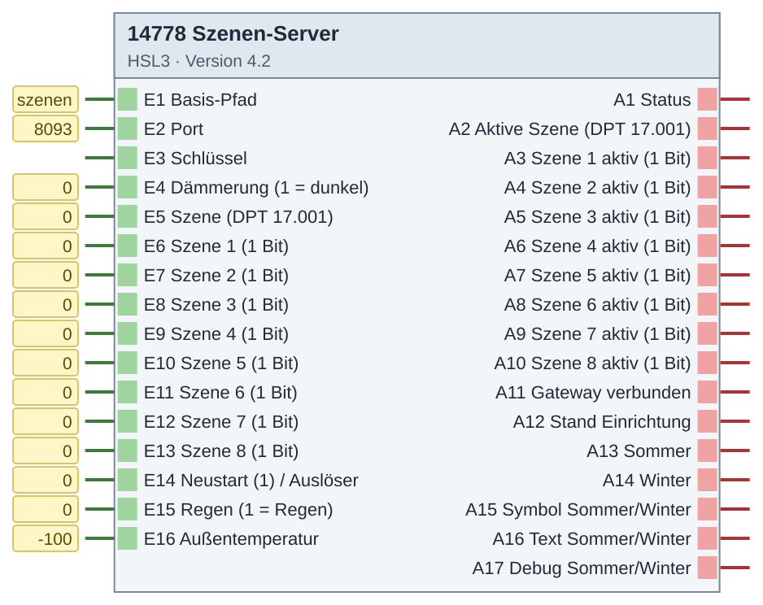
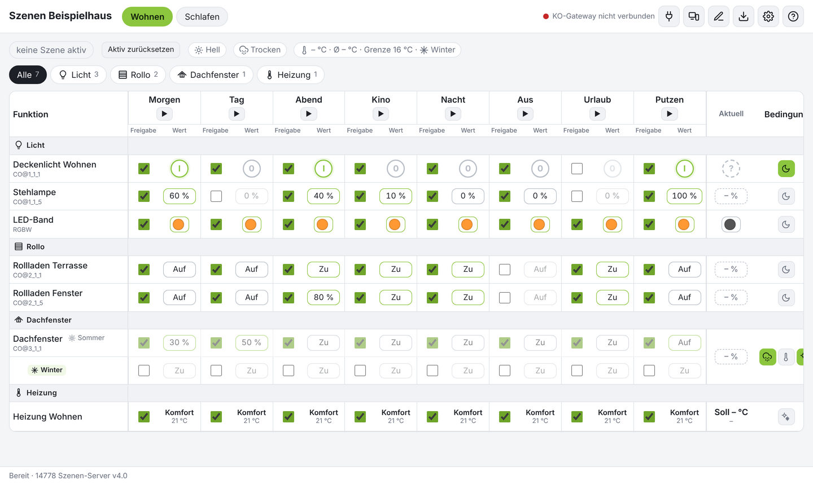

# 14778 Szenen-Server – Version 4.2

**ID 14778 · Version 4.2 · HSL3**

Szenensteuerung über eigene Webseite.

Der HomeServer leitet `https://<HS>/szenen/` an den Baustein (Port 8093) weiter – gleiche Adresse und gleiches Zertifikat wie der HS.

## Baustein

## Beispiel

**Ergebnis: Szenen-Seite mit Beispiel-Szenen (ohne Verbindung zum HS aufgenommen)**

## Eingänge

- E1 Basis-Pfad
- E2 Port
- E3 Schlüssel
- E4 Dämmerung (1 = dunkel)
- E5 Szene (DPT 17.001)
- E6 Szene 1 (1 Bit)
- E7 Szene 2 (1 Bit)
- E8 Szene 3 (1 Bit)
- E9 Szene 4 (1 Bit)
- E10 Szene 5 (1 Bit)
- E11 Szene 6 (1 Bit)
- E12 Szene 7 (1 Bit)
- E13 Szene 8 (1 Bit)
- E14 Neustart (1) / Auslöser
- E15 Regen (1 = Regen)
- E16 Außentemperatur

## Ausgänge

- A1 Status
- A2 Aktive Szene (DPT 17.001)
- A3 Szene 1 aktiv (1 Bit)
- A4 Szene 2 aktiv (1 Bit)
- A5 Szene 3 aktiv (1 Bit)
- A6 Szene 4 aktiv (1 Bit)
- A7 Szene 5 aktiv (1 Bit)
- A8 Szene 6 aktiv (1 Bit)
- A9 Szene 7 aktiv (1 Bit)
- A10 Szene 8 aktiv (1 Bit)
- A11 Gateway verbunden
- A12 Stand Einrichtung
- A13 Sommer
- A14 Winter
- A15 Symbol Sommer/Winter
- A16 Text Sommer/Winter
- A17 Debug Sommer/Winter

## Dateien

- `14778_szenenserver.hslz` – Import im Experten: Logikbausteine → Importieren
- `Quellen/DE-log14778.html` – ausführliche Hilfe (im Experten über die Bausteinhilfe)
- `Quellen/src/…py`, `Quellen/config.json` – Quellcode; die `.hsl` erzeugt der Gira-Generator (HSL3 SDK, nicht enthalten)

iKOs bei Bedarf per CSV-Import anlegen: Kommunikationsobjekte → Extras → Datenabgleich → CSV-Datei synchronisieren/importieren.

[← zur Übersicht](../README.md)
