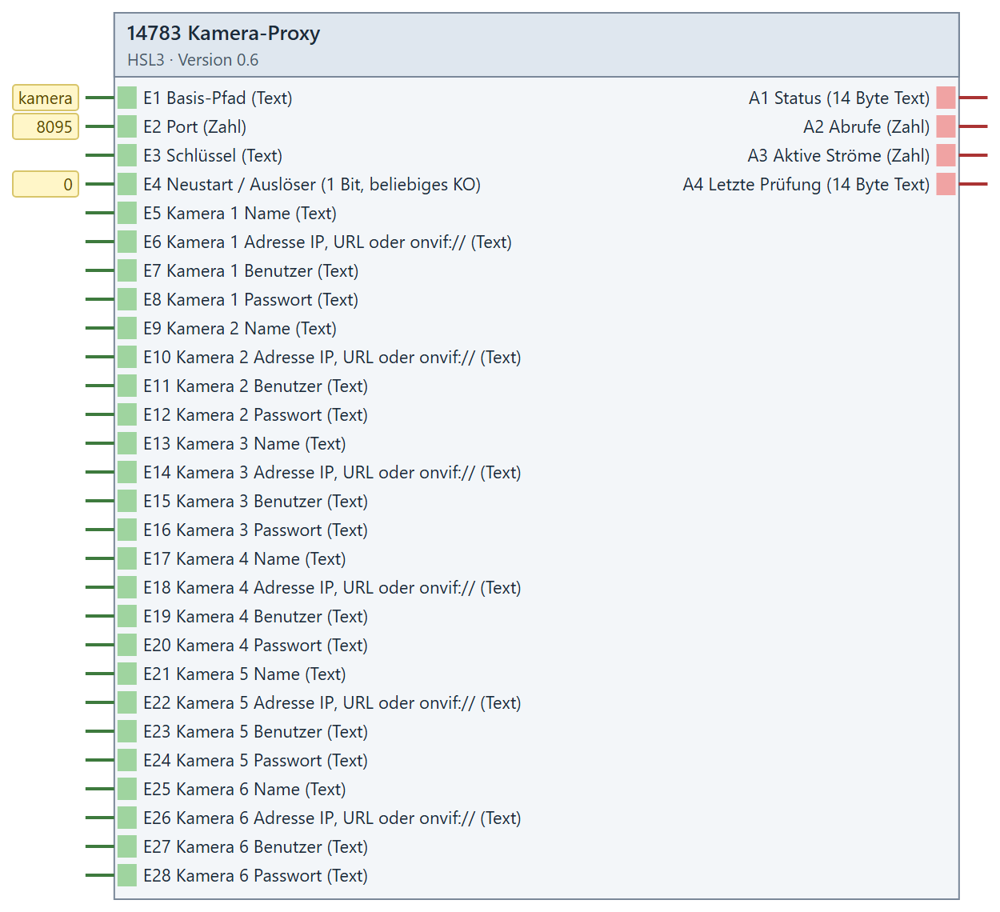
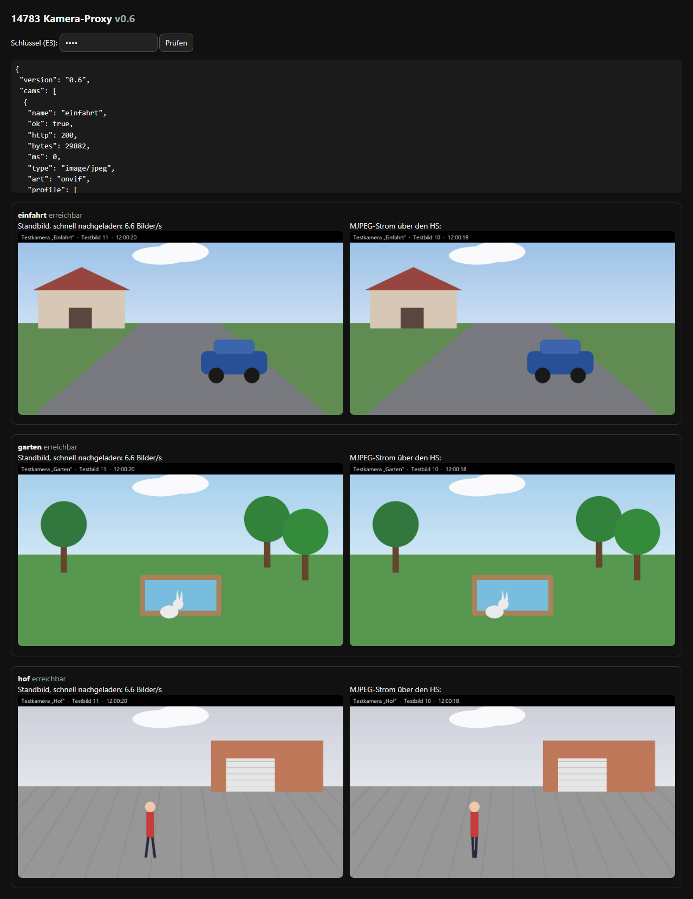
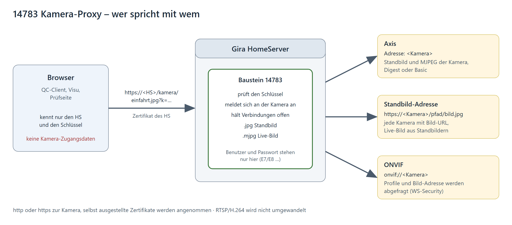

# 14783 Kamera-Proxy – Version 0.5

**ID 14783 · Version 0.5 · HSL3**

Kamerabilder für QC-Client und Visu ohne Anmeldung im Browser – Axis, beliebige Standbild-Adresse oder ONVIF, bis zu 6 Kameras; Standbild und Live-Bild (MJPEG der Kamera oder aus Standbildern) über die Adresse des HomeServers.

Der HomeServer leitet `https://<HS>/kamera/` an den Baustein (Port 8095) weiter – gleiche Adresse und gleiches Zertifikat wie der HS.

## Baustein



## Beispiel

**Ergebnis: Prüfseite mit drei Testkameras (ONVIF, Standbild-Adresse, Axis) – links Standbild schnell nachgeladen, rechts Live-Bild**



**Prinzip: Der Browser spricht nur mit dem HomeServer, der Baustein meldet sich an der Kamera an**



## Wozu

Ein Browser kann sich an einer Netzwerkkamera nicht still anmelden, kann kein RTSP und stört sich am selbst ausgestellten Zertifikat der Kamera. Der Baustein holt die Bilder deshalb selbst von der Kamera und reicht sie über den HomeServer weiter:

- Der Browser spricht nur mit dem HomeServer (`https://<HS>/kamera/…`) und braucht nur einen Schlüssel.
- Benutzer und Passwort der Kamera stehen nur im Baustein und werden nie ausgegeben.
- Bis zu 6 Kameras je Baustein.

## Adresse der Kamera – drei Arten

Die Art ergibt sich aus dem Eintrag in „Adresse“ (E6, E10, E14, E18, E22, E26):

| Eintrag | Art | Verhalten |
|---|---|---|
| `<Kamera>` oder `https://<Kamera>` | Axis | Standbild `/axis-cgi/jpg/image.cgi`, Live-Bild `/axis-cgi/mjpg/video.cgi` (MJPEG der Kamera, unverändert durchgereicht). Braucht ein normales Axis-Konto. |
| `https://<Kamera>/pfad/bild.jpg?…` | Standbild-Adresse | Genau diese Adresse wird als Standbild abgerufen, alle Parameter bleiben erhalten. Live-Bild aus Standbildern. |
| `onvif://<Kamera>` | ONVIF | Der Baustein fragt die Kamera nach Profilen und Standbild-Adresse. Erst https, dann http. Live-Bild aus Standbildern. |

`<Kamera>` steht für IP-Adresse oder Name der Kamera, bei Bedarf mit Port (`<Kamera>:8080`).

### Beispiele für „Adresse“

| Eintrag | Wirkung |
|---|---|
| `https://<Kamera>` | Axis über https, Auflösung wie in der Kamera eingestellt |
| `https://<Kamera>?resolution=1280x720&compression=25` | Axis mit Vorgabe für Auflösung und Kompression |
| `https://<Kamera>?camera=2` | Axis-Mehrkanalgerät, zweiter Kanal |
| `https://<Kamera>/onvif-cgi/jpg/image.cgi?resolution=1280x720&compression=30` | Axis mit ONVIF-Konto, feste Standbild-Adresse |
| `http://<Kamera>/snapshot.jpg` | beliebige Kamera mit Bild-URL |
| `onvif://<Kamera>` | ONVIF, Standbild in etwa 1280×720 |
| `onvif://<Kamera>?resolution=960x540` | ONVIF mit kleinerem Bild (flüssiger) |

Axis führt ONVIF-Konten getrennt von den normalen Konten: Ein ONVIF-Konto gilt für `onvif://…` und `/onvif-cgi/…`, nicht für `/axis-cgi/…` (dort kommt „401“).

## Adressen für Browser und QC-Client

| Adresse | Inhalt |
|---|---|
| `https://<HS>/kamera/` | Prüfseite (Bild oben): Schlüssel eingeben, zeigt je Kamera Standbild mit Bildern/s und Live-Bild |
| `https://<HS>/kamera/einfahrt.jpg?k=<Schlüssel>` | Standbild der Kamera „einfahrt“ |
| `https://<HS>/kamera/einfahrt.mjpg?k=<Schlüssel>` | Live-Bild als MJPEG-Strom |
| `https://<HS>/kamera/einfahrt.jpg?k=<Schlüssel>&resolution=640x360` | Standbild in anderer Auflösung |
| `https://<HS>/kamera/einfahrt.mjpg?k=<Schlüssel>&fps=5` | Live-Bild mit 5 Bildern/s |
| `https://<HS>/kamera/list?k=<Schlüssel>` | Namen der Kameras: `{"version":"0.5","cams":["einfahrt","hof"]}` |
| `https://<HS>/kamera/test?k=<Schlüssel>` | Prüfung aller Kameras als JSON |

Zusatz-Parameter: `resolution`, `fps`, `compression`, `camera`. Lehnt die Kamera einen Parameter ab (HTTP 400), geht es mit der Vorgabe aus „Adresse“ weiter.

In eine Webseite eingebunden:

```html
/kamera/einfahrt.mjpg?k=<Schlüssel>" alt="Einfahrt">
```

## Live-Bild

- Bietet die Kamera einen MJPEG-Strom (Axis), wird er unverändert durchgereicht.
- Sonst baut der Baustein den Strom aus schnell nachgeladenen Standbildern: Vorgabe 8 Bilder/s, mit `&fps=…` 1 bis 15. Wie viele Bilder wirklich ankommen, hängt von Kamera, Auflösung und HomeServer ab; die Prüfseite zeigt den Wert.
- RTSP/H.264 wandelt der Baustein nicht um. Die RTSP-Adresse einer ONVIF-Kamera zeigt die Prüfseite nur an.
- Je Kamera höchstens 4 Zuschauer gleichzeitig.

## Prüfung lesen

`…/test?k=<Schlüssel>` (auch oben auf der Prüfseite) zeigt je Kamera, was der Baustein erreicht hat. Beispiel einer ONVIF-Kamera:

```json
{
 "name": "einfahrt",
 "ok": true,
 "http": 200,
 "bytes": 85183,
 "ms": 272,
 "art": "onvif",
 "profile": ["profile_1 h264 3840x2160 H264", "profile_1 jpeg 3840x2160 JPEG"],
 "profil": "profile_1 h264 3840x2160",
 "strom": "rtsp://…/onvif-media/media.amp?profile=profile_1_h264",
 "uhr": "-130 s",
 "live": "Standbilder"
}
```

| Anzeige | Bedeutung |
|---|---|
| `art` | `axis`, `url` (Standbild-Adresse) oder `onvif` |
| `ms` | Zeit für ein Standbild mit gespeicherter Anmeldung |
| `profile` / `profil` | alle Profile der Kamera / das gewählte |
| `strom` | RTSP-Adresse der Kamera, nur zur Auskunft (ohne Host und Zugangsdaten) |
| `uhr` | Abweichung der Kamera-Uhr vom HomeServer; der Baustein gleicht sie für die ONVIF-Anmeldung aus |
| `http: 401` | Benutzer oder Passwort falsch (bei Axis: ONVIF-Konto an Axis-Pfaden?) |
| `http: 400` | Kamera lehnt die Anfrage ab, Grund in `detail` |
| `http: 404` | Pfad gibt es nicht – ganze Standbild-Adresse oder `onvif://…` eintragen |
| Fehler ohne `http` | Kamera nicht erreichbar (Adresse, Port, http/https) |

## Im QC-Client

Im Experten bleibt das Kamera-Plugin, wie es ist. Im [QC-Client](https://github.com/BadSmiley0815/QC-Client) links unter **Kamera-Proxy** einmal `https://<HS>/kamera/` und den Schlüssel eintragen. Kameras, deren Name im Plugin zum Namen im Baustein passt („Einfahrt“ → `einfahrt`), laufen dann über den Proxy.

## Stand der Prüfung

- An echten Kameras geprüft (15.11.2026): zwei Axis-Kameras über die Axis-Pfade, eine Axis P1468-LE über `onvif://` (https, selbst ausgestelltes Zertifikat).
- Nur mit nachgebauten Kameras getestet: Standbild-Adresse mit Pfad, Kameras anderer Hersteller, Kameras ohne MJPEG an den Axis-Pfaden.
- Die Bilder auf dieser Seite stammen von Testkameras (gezeichnete Testbilder), nicht von einer echten Anlage.

## Sicherheit

Der Schlüssel steht in jeder Bild-Adresse und ist für jeden Benutzer der Visu sichtbar. An der Kamera deshalb einen eigenen Benutzer nur mit Zuschauer-Recht anlegen.

## Eingänge

- E1 Basis-Pfad (Text)
- E2 Port (Zahl)
- E3 Schlüssel (Text)
- E4 Neustart / Auslöser (1 Bit, beliebiges KO)
- E5 Kamera 1 Name (Text)
- E6 Kamera 1 Adresse IP, URL oder onvif:// (Text)
- E7 Kamera 1 Benutzer (Text)
- E8 Kamera 1 Passwort (Text)
- E9 Kamera 2 Name (Text)
- E10 Kamera 2 Adresse IP, URL oder onvif:// (Text)
- E11 Kamera 2 Benutzer (Text)
- E12 Kamera 2 Passwort (Text)
- E13 Kamera 3 Name (Text)
- E14 Kamera 3 Adresse IP, URL oder onvif:// (Text)
- E15 Kamera 3 Benutzer (Text)
- E16 Kamera 3 Passwort (Text)
- E17 Kamera 4 Name (Text)
- E18 Kamera 4 Adresse IP, URL oder onvif:// (Text)
- E19 Kamera 4 Benutzer (Text)
- E20 Kamera 4 Passwort (Text)
- E21 Kamera 5 Name (Text)
- E22 Kamera 5 Adresse IP, URL oder onvif:// (Text)
- E23 Kamera 5 Benutzer (Text)
- E24 Kamera 5 Passwort (Text)
- E25 Kamera 6 Name (Text)
- E26 Kamera 6 Adresse IP, URL oder onvif:// (Text)
- E27 Kamera 6 Benutzer (Text)
- E28 Kamera 6 Passwort (Text)

## Ausgänge

- A1 Status (14 Byte Text)
- A2 Abrufe (Zahl)
- A3 Aktive Ströme (Zahl)
- A4 Letzte Prüfung (14 Byte Text)

## Dateien

- `14783_kameraproxy.hslz` – Import im Experten: Logikbausteine → Importieren
- `Quellen/DE-log14783.html` – ausführliche Hilfe (im Experten über die Bausteinhilfe)
- `Quellen/src/…py`, `Quellen/config.json` – Quellcode; die `.hsl` erzeugt der Gira-Generator (HSL3 SDK, nicht enthalten)
- [`Anleitung_Einbau.md`](Anleitung_Einbau.md) – Einbau Schritt für Schritt

iKOs bei Bedarf per CSV-Import anlegen: Kommunikationsobjekte → Extras → Datenabgleich → CSV-Datei synchronisieren/importieren.

[← zur Übersicht](../README.md)
