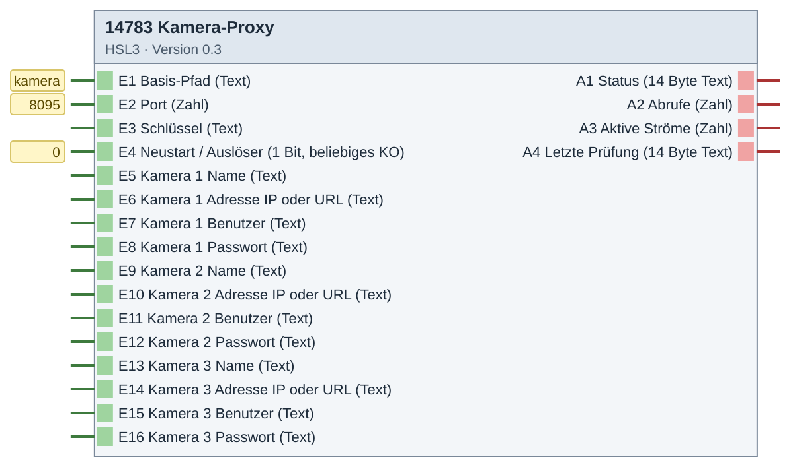
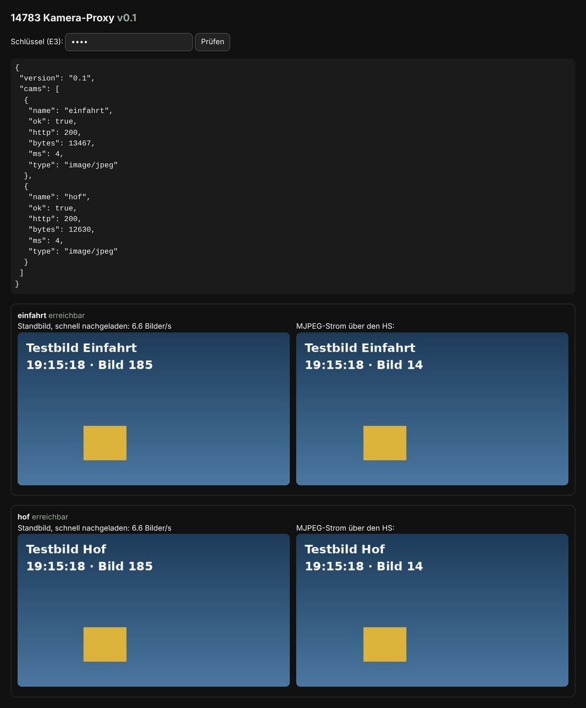

# 14783 Kamera-Proxy – Version 0.3

**ID 14783 · Version 0.3 · HSL3**

Axis-Kameras per Digest für den QC-Client.

Der HomeServer leitet `https://<HS>/kamera/` an den Baustein (Port 8095) weiter – gleiche Adresse und gleiches Zertifikat wie der HS.

## Baustein

## Beispiel

**Ergebnis: Prüfseite mit zwei Testkameras – Standbild schnell nachgeladen und MJPEG-Strom**

## Eingänge

- E1 Basis-Pfad (Text)
- E2 Port (Zahl)
- E3 Schlüssel (Text)
- E4 Neustart / Auslöser (1 Bit, beliebiges KO)
- E5 Kamera 1 Name (Text)
- E6 Kamera 1 Adresse IP oder URL (Text)
- E7 Kamera 1 Benutzer (Text)
- E8 Kamera 1 Passwort (Text)
- E9 Kamera 2 Name (Text)
- E10 Kamera 2 Adresse IP oder URL (Text)
- E11 Kamera 2 Benutzer (Text)
- E12 Kamera 2 Passwort (Text)
- E13 Kamera 3 Name (Text)
- E14 Kamera 3 Adresse IP oder URL (Text)
- E15 Kamera 3 Benutzer (Text)
- E16 Kamera 3 Passwort (Text)

## Ausgänge

- A1 Status (14 Byte Text)
- A2 Abrufe (Zahl)
- A3 Aktive Ströme (Zahl)
- A4 Letzte Prüfung (14 Byte Text)

## Dateien

- `14783_kameraproxy.hslz` – Import im Experten: Logikbausteine → Importieren
- `Quellen/DE-log14783.html` – ausführliche Hilfe (im Experten über die Bausteinhilfe)
- `Quellen/src/…py`, `Quellen/config.json` – Quellcode; die `.hsl` erzeugt der Gira-Generator (HSL3 SDK, nicht enthalten)
- [`Anleitung_Einbau.md`](Anleitung_Einbau.md) – Einbau Schritt für Schritt

iKOs bei Bedarf per CSV-Import anlegen: Kommunikationsobjekte → Extras → Datenabgleich → CSV-Datei synchronisieren/importieren.

[← zur Übersicht](../README.md)
