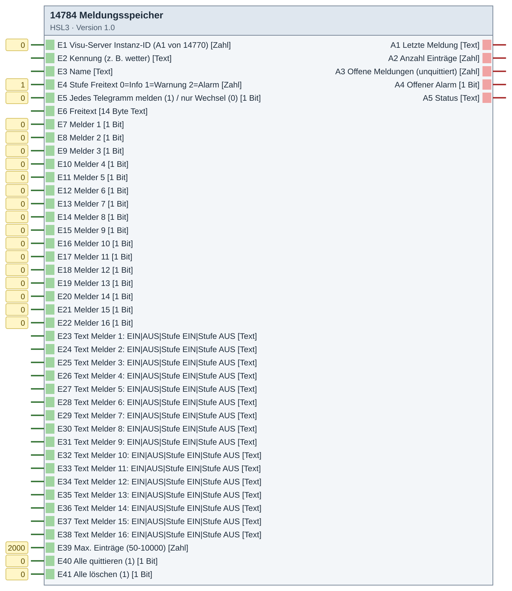

# 14784 Meldungsspeicher – Version 1.0

**ID 14784 · Version 1.0 · HSL3**

Eigenes Meldungsarchiv (z. B. Wetterstation, Alarmanlage) – 16 Melder mit Texten, Freitext, Quittieren; Abruf über den Visu-Server 14770.

## Baustein

## Eingänge

- E1 Visu-Server Instanz-ID (A1 von 14770) [Zahl]
- E2 Kennung (z. B. wetter) [Text]
- E3 Name [Text]
- E4 Stufe Freitext 0=Info 1=Warnung 2=Alarm [Zahl]
- E5 Jedes Telegramm melden (1) / nur Wechsel (0) [1 Bit]
- E6 Freitext [14 Byte Text]
- E7 Melder 1 [1 Bit]
- E8 Melder 2 [1 Bit]
- E9 Melder 3 [1 Bit]
- E10 Melder 4 [1 Bit]
- E11 Melder 5 [1 Bit]
- E12 Melder 6 [1 Bit]
- E13 Melder 7 [1 Bit]
- E14 Melder 8 [1 Bit]
- E15 Melder 9 [1 Bit]
- E16 Melder 10 [1 Bit]
- E17 Melder 11 [1 Bit]
- E18 Melder 12 [1 Bit]
- E19 Melder 13 [1 Bit]
- E20 Melder 14 [1 Bit]
- E21 Melder 15 [1 Bit]
- E22 Melder 16 [1 Bit]
- E23 Text Melder 1: EIN|AUS|Stufe EIN|Stufe AUS [Text]
- E24 Text Melder 2: EIN|AUS|Stufe EIN|Stufe AUS [Text]
- E25 Text Melder 3: EIN|AUS|Stufe EIN|Stufe AUS [Text]
- E26 Text Melder 4: EIN|AUS|Stufe EIN|Stufe AUS [Text]
- E27 Text Melder 5: EIN|AUS|Stufe EIN|Stufe AUS [Text]
- E28 Text Melder 6: EIN|AUS|Stufe EIN|Stufe AUS [Text]
- E29 Text Melder 7: EIN|AUS|Stufe EIN|Stufe AUS [Text]
- E30 Text Melder 8: EIN|AUS|Stufe EIN|Stufe AUS [Text]
- E31 Text Melder 9: EIN|AUS|Stufe EIN|Stufe AUS [Text]
- E32 Text Melder 10: EIN|AUS|Stufe EIN|Stufe AUS [Text]
- E33 Text Melder 11: EIN|AUS|Stufe EIN|Stufe AUS [Text]
- E34 Text Melder 12: EIN|AUS|Stufe EIN|Stufe AUS [Text]
- E35 Text Melder 13: EIN|AUS|Stufe EIN|Stufe AUS [Text]
- E36 Text Melder 14: EIN|AUS|Stufe EIN|Stufe AUS [Text]
- E37 Text Melder 15: EIN|AUS|Stufe EIN|Stufe AUS [Text]
- E38 Text Melder 16: EIN|AUS|Stufe EIN|Stufe AUS [Text]
- E39 Max. Einträge (50-10000) [Zahl]
- E40 Alle quittieren (1) [1 Bit]
- E41 Alle löschen (1) [1 Bit]

## Ausgänge

- A1 Letzte Meldung [Text]
- A2 Anzahl Einträge [Zahl]
- A3 Offene Meldungen (unquittiert) [Zahl]
- A4 Offener Alarm [1 Bit]
- A5 Status [Text]

## Dateien

- `14784_meldungsspeicher.hslz` – Import im Experten: Logikbausteine → Importieren
- `Quellen/DE-log14784.html` – ausführliche Hilfe (im Experten über die Bausteinhilfe)
- `Quellen/src/…py`, `Quellen/config.json` – Quellcode; die `.hsl` erzeugt der Gira-Generator (HSL3 SDK, nicht enthalten)

iKOs bei Bedarf per CSV-Import anlegen: Kommunikationsobjekte → Extras → Datenabgleich → CSV-Datei synchronisieren/importieren.

[← zur Übersicht](../README.md)
