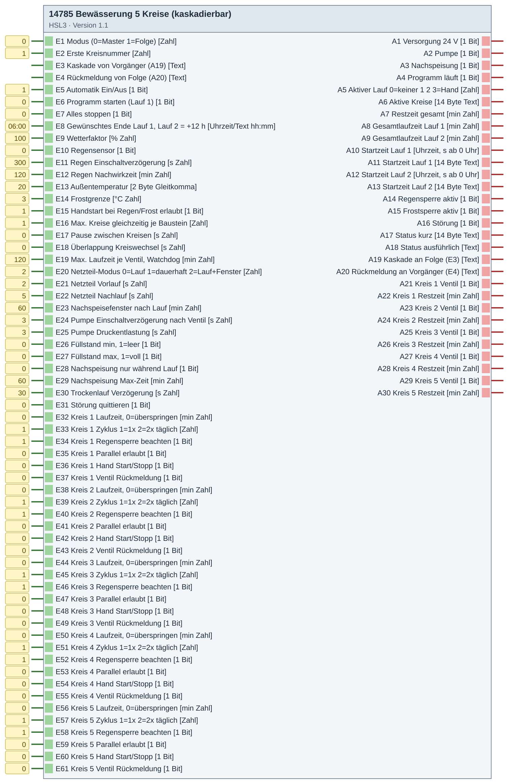
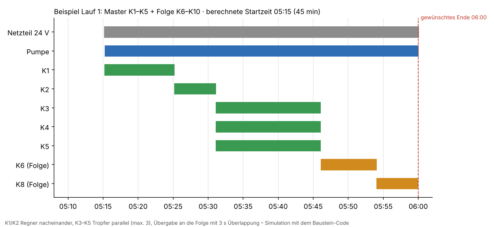

# 14785 Bewässerung 5 Kreise (kaskadierbar) – Version 1.1

**ID 14785 · Version 1.1 · HSL3**

Gartenbewässerung, 5 Kreise je Baustein, per Kaskade erweiterbar (Master/Folge); Endzeit statt Startzeit, Lauf 1/2 (12 h), Regen-/Frostsperre, Parallel/Überlappung, Netzteil 24 V, Pumpe, Nachspeisung, Trockenlauf, Zeit ab Ventil-Rückmeldung (auch bei Fremdschaltung).

## Baustein

## Beispiel

**Beispiel: Lauf 1 mit Master und einer Folge – Startzeit aus der gewünschten Endzeit (Simulation mit dem Baustein-Code)**

## Eingänge

- E1 Modus (0=Master 1=Folge) [Zahl]
- E2 Erste Kreisnummer [Zahl]
- E3 Kaskade von Vorgänger (A19) [Text]
- E4 Rückmeldung von Folge (A20) [Text]
- E5 Automatik Ein/Aus [1 Bit]
- E6 Programm starten (Lauf 1) [1 Bit]
- E7 Alles stoppen [1 Bit]
- E8 Gewünschtes Ende Lauf 1, Lauf 2 = +12 h [Uhrzeit/Text hh:mm]
- E9 Wetterfaktor [% Zahl]
- E10 Regensensor [1 Bit]
- E11 Regen Einschaltverzögerung [s Zahl]
- E12 Regen Nachwirkzeit [min Zahl]
- E13 Außentemperatur [2 Byte Gleitkomma]
- E14 Frostgrenze [°C Zahl]
- E15 Handstart bei Regen/Frost erlaubt [1 Bit]
- E16 Max. Kreise gleichzeitig je Baustein [Zahl]
- E17 Pause zwischen Kreisen [s Zahl]
- E18 Überlappung Kreiswechsel [s Zahl]
- E19 Max. Laufzeit je Ventil, Watchdog [min Zahl]
- E20 Netzteil-Modus 0=Lauf 1=dauerhaft 2=Lauf+Fenster [Zahl]
- E21 Netzteil Vorlauf [s Zahl]
- E22 Netzteil Nachlauf [s Zahl]
- E23 Nachspeisefenster nach Lauf [min Zahl]
- E24 Pumpe Einschaltverzögerung nach Ventil [s Zahl]
- E25 Pumpe Druckentlastung [s Zahl]
- E26 Füllstand min, 1=leer [1 Bit]
- E27 Füllstand max, 1=voll [1 Bit]
- E28 Nachspeisung nur während Lauf [1 Bit]
- E29 Nachspeisung Max-Zeit [min Zahl]
- E30 Trockenlauf Verzögerung [s Zahl]
- E31 Störung quittieren [1 Bit]
- E32 Kreis 1 Laufzeit, 0=überspringen [min Zahl]
- E33 Kreis 1 Zyklus 1=1x 2=2x täglich [Zahl]
- E34 Kreis 1 Regensperre beachten [1 Bit]
- E35 Kreis 1 Parallel erlaubt [1 Bit]
- E36 Kreis 1 Hand Start/Stopp [1 Bit]
- E37 Kreis 1 Ventil Rückmeldung [1 Bit]
- E38 Kreis 2 Laufzeit, 0=überspringen [min Zahl]
- E39 Kreis 2 Zyklus 1=1x 2=2x täglich [Zahl]
- E40 Kreis 2 Regensperre beachten [1 Bit]
- E41 Kreis 2 Parallel erlaubt [1 Bit]
- E42 Kreis 2 Hand Start/Stopp [1 Bit]
- E43 Kreis 2 Ventil Rückmeldung [1 Bit]
- E44 Kreis 3 Laufzeit, 0=überspringen [min Zahl]
- E45 Kreis 3 Zyklus 1=1x 2=2x täglich [Zahl]
- E46 Kreis 3 Regensperre beachten [1 Bit]
- E47 Kreis 3 Parallel erlaubt [1 Bit]
- E48 Kreis 3 Hand Start/Stopp [1 Bit]
- E49 Kreis 3 Ventil Rückmeldung [1 Bit]
- E50 Kreis 4 Laufzeit, 0=überspringen [min Zahl]
- E51 Kreis 4 Zyklus 1=1x 2=2x täglich [Zahl]
- E52 Kreis 4 Regensperre beachten [1 Bit]
- E53 Kreis 4 Parallel erlaubt [1 Bit]
- E54 Kreis 4 Hand Start/Stopp [1 Bit]
- E55 Kreis 4 Ventil Rückmeldung [1 Bit]
- E56 Kreis 5 Laufzeit, 0=überspringen [min Zahl]
- E57 Kreis 5 Zyklus 1=1x 2=2x täglich [Zahl]
- E58 Kreis 5 Regensperre beachten [1 Bit]
- E59 Kreis 5 Parallel erlaubt [1 Bit]
- E60 Kreis 5 Hand Start/Stopp [1 Bit]
- E61 Kreis 5 Ventil Rückmeldung [1 Bit]

## Ausgänge

- A1 Versorgung 24 V [1 Bit]
- A2 Pumpe [1 Bit]
- A3 Nachspeisung [1 Bit]
- A4 Programm läuft [1 Bit]
- A5 Aktiver Lauf 0=keiner 1 2 3=Hand [Zahl]
- A6 Aktive Kreise [14 Byte Text]
- A7 Restzeit gesamt [min Zahl]
- A8 Gesamtlaufzeit Lauf 1 [min Zahl]
- A9 Gesamtlaufzeit Lauf 2 [min Zahl]
- A10 Startzeit Lauf 1 [Uhrzeit, s ab 0 Uhr]
- A11 Startzeit Lauf 1 [14 Byte Text]
- A12 Startzeit Lauf 2 [Uhrzeit, s ab 0 Uhr]
- A13 Startzeit Lauf 2 [14 Byte Text]
- A14 Regensperre aktiv [1 Bit]
- A15 Frostsperre aktiv [1 Bit]
- A16 Störung [1 Bit]
- A17 Status kurz [14 Byte Text]
- A18 Status ausführlich [Text]
- A19 Kaskade an Folge (E3) [Text]
- A20 Rückmeldung an Vorgänger (E4) [Text]
- A21 Kreis 1 Ventil [1 Bit]
- A22 Kreis 1 Restzeit [min Zahl]
- A23 Kreis 2 Ventil [1 Bit]
- A24 Kreis 2 Restzeit [min Zahl]
- A25 Kreis 3 Ventil [1 Bit]
- A26 Kreis 3 Restzeit [min Zahl]
- A27 Kreis 4 Ventil [1 Bit]
- A28 Kreis 4 Restzeit [min Zahl]
- A29 Kreis 5 Ventil [1 Bit]
- A30 Kreis 5 Restzeit [min Zahl]

## Dateien

- `14785_Bewaesserung.hslz` – Import im Experten: Logikbausteine → Importieren
- `Quellen/DE-log14785.html` – ausführliche Hilfe (im Experten über die Bausteinhilfe)
- `Quellen/src/…py`, `Quellen/config.json` – Quellcode; die `.hsl` erzeugt der Gira-Generator (HSL3 SDK, nicht enthalten)

iKOs bei Bedarf per CSV-Import anlegen: Kommunikationsobjekte → Extras → Datenabgleich → CSV-Datei synchronisieren/importieren.

[← zur Übersicht](../README.md)
