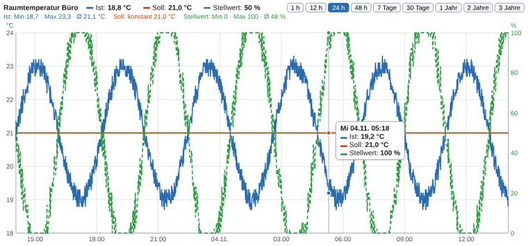
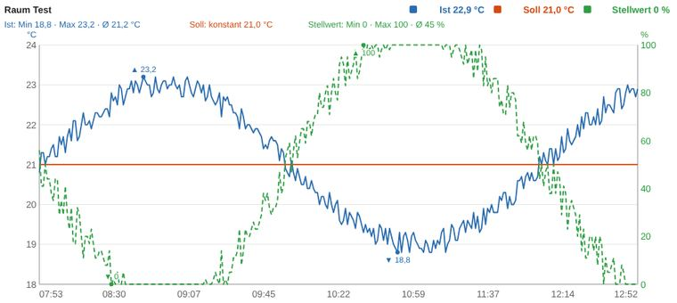
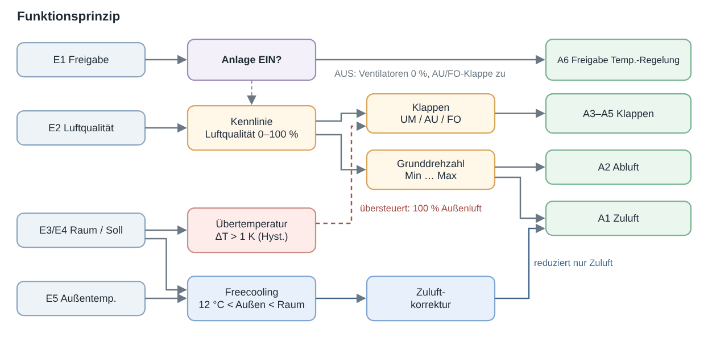
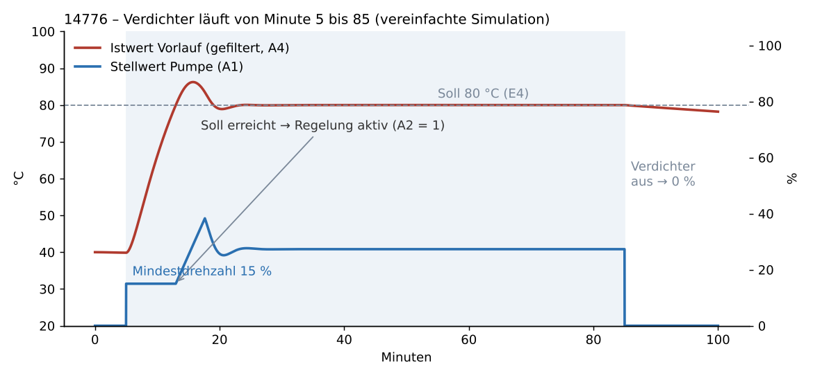
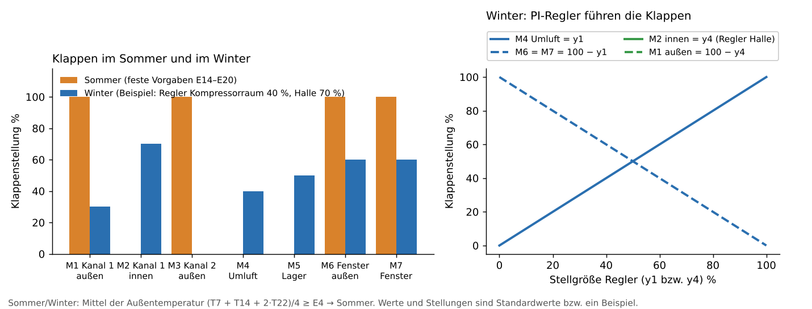
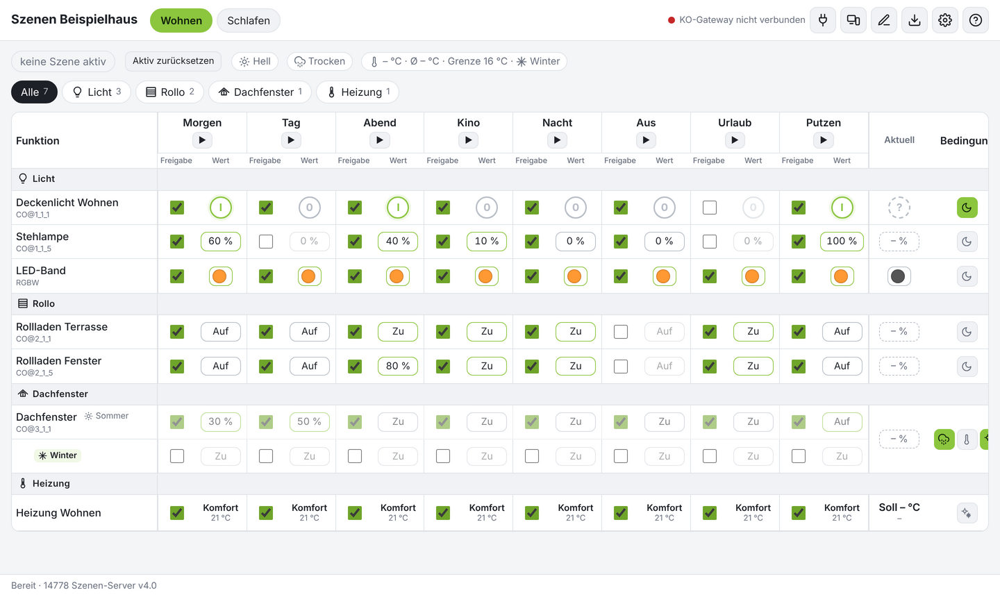
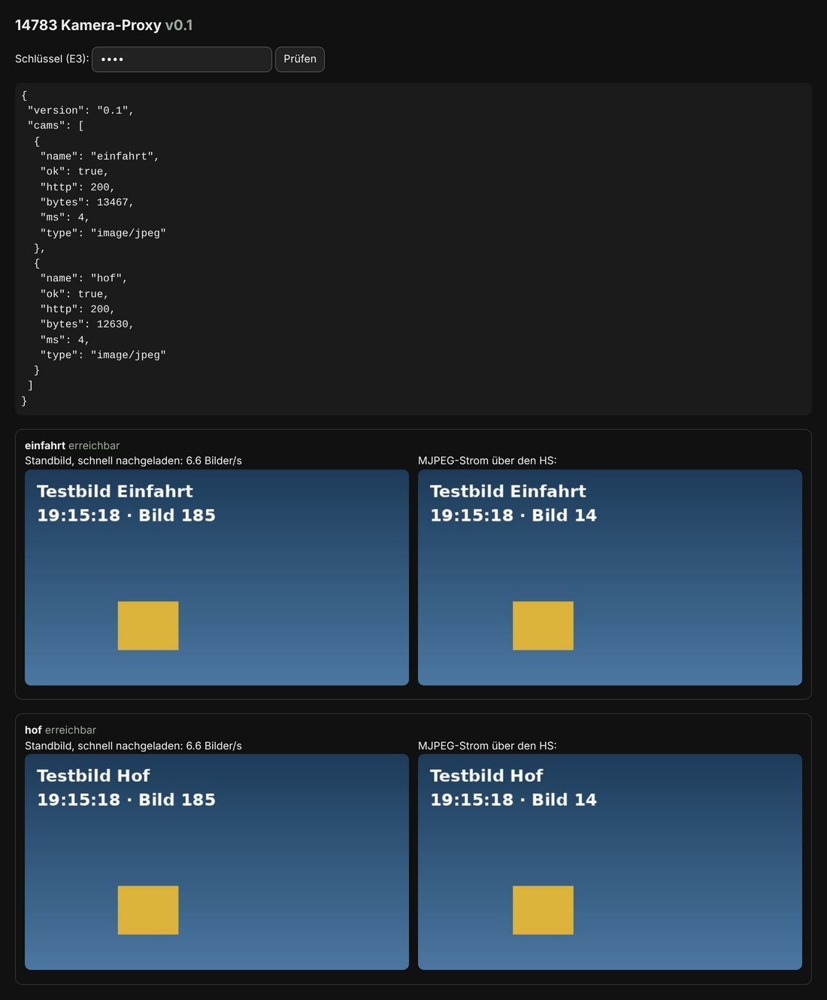

# HS-Logikbausteine

Freie Logikbausteine (HSL3 und HSL 1.0) für den Gira HomeServer / FacilityServer – mit Quellcode, Hilfe, Bild und Beispiel.
Jeder Ordner enthält die importierbare `.hslz` bzw. `.hsl` und eine README.

Passend dazu: [QC-Client](https://github.com/BadSmiley0815/QC-Client) – der QuadClient im Browser.

Stand 10.11.2026 · ID-Bereich 14770–14789 · nächste freie ID **14784**

## Bausteine

| ID | Baustein | Version | Port / Pfad |
|---|---|---|---|
| 14770 | [Visu-Server](14770_visuserver/) | 1.10 | 8092 `/visu-daten/` |
| 14771 | [Verlaufsspeicher für Diagramme](14771_verlauf/) | 2.7 |  |
| 14772 | KNX-Tunnel Senden – noch nicht veröffentlicht | ? |  |
| 14773 | KNX-Tunnel Empfangen – noch nicht veröffentlicht | ? |  |
| 14774 | KNX-Tunnel Gateway-Server – noch nicht veröffentlicht | ? |  |
| 14775 | [RLT Luftqualitätsregelung](14775_RLT_Luftqualitaet/) | 1.6 |  |
| 14776 | [WRG-Pumpenregelung](14776_WRG_Pumpenregelung/) | 1.0 |  |
| 14777 | [Kompressor-Klappensteuerung](14777_Kompressor_Klappensteuerung/) | 1.2 |  |
| 14778 | [Szenen-Server](14778_szenenserver/) | 4.2 | 8093 `/szenen/` |
| 14779 | Zeitschaltuhr + Aufzeichnung – geplant | – | 8094 (reserviert) |
| 14780 | (verworfene Parallelfassung KNX-Tunnel) – nicht verwenden | – |  |
| 14781 | (verworfene Parallelfassung KNX-Tunnel) – nicht verwenden | – |  |
| 14782 | (verworfene Parallelfassung KNX-Tunnel) – nicht verwenden | – |  |
| 14783 | [Kamera-Proxy](14783_kameraproxy/) | 0.4 (Prüffassung) | 8095 `/kamera/` |

## Auf einen Blick

### [14770 Visu-Server](14770_visuserver/)

homeserver-webapp, Diagramme.

### [14771 Verlaufsspeicher für Diagramme](14771_verlauf/)

zusammen mit 14770.

### [14775 RLT Luftqualitätsregelung](14775_RLT_Luftqualitaet/)

Lüftungsanlage (RLT) mit Luftqualitätsregelung.

### [14776 WRG-Pumpenregelung](14776_WRG_Pumpenregelung/)

WRG-Pumpe an einem Druckluft-Kompressor.

### [14777 Kompressor-Klappensteuerung](14777_Kompressor_Klappensteuerung/)

Klappen eines Kompressorraums (Sommer/Winter).

### [14778 Szenen-Server](14778_szenenserver/)

Szenensteuerung über eigene Webseite.

### [14783 Kamera-Proxy](14783_kameraproxy/)

Axis-Kameras per Digest für den QC-Client.

## Regeln

- ID steht im Namen (alle Sprachen), ID und Version stehen in der Hilfe.
- Neue Bausteine bekommen die nächste freie ID aus 14770–14789.
- HTTP-Bausteine: der HS leitet https://<HS>/<Basis-Pfad>/ an den Port weiter – gleiche Adresse und gleiches Zertifikat wie der HS. Port nie 0 (sonst 503) und nie doppelt.
- iKOs per Experte-CSV-Import anlegen (Kommunikationsobjekte → Extras → Datenabgleich → CSV-Datei synchronisieren/importieren).

## Lizenz

GPL-3.0, siehe [LICENSE](LICENSE). Entwickelt mit Claude (Anthropic). Gira, HomeServer und QuadClient sind Marken der Gira Giersiepen GmbH & Co. KG; dieses Projekt ist kein Produkt von Gira. Der Gira-Generator (HSL3 SDK) ist nicht enthalten.

Bilder neu erzeugen: `python3 tools/blockbild.py <Ordner>` (Baustein), `python3 tools/prinzipbilder.py` (14776/14777), danach `python3 tools/readmes.py`.
